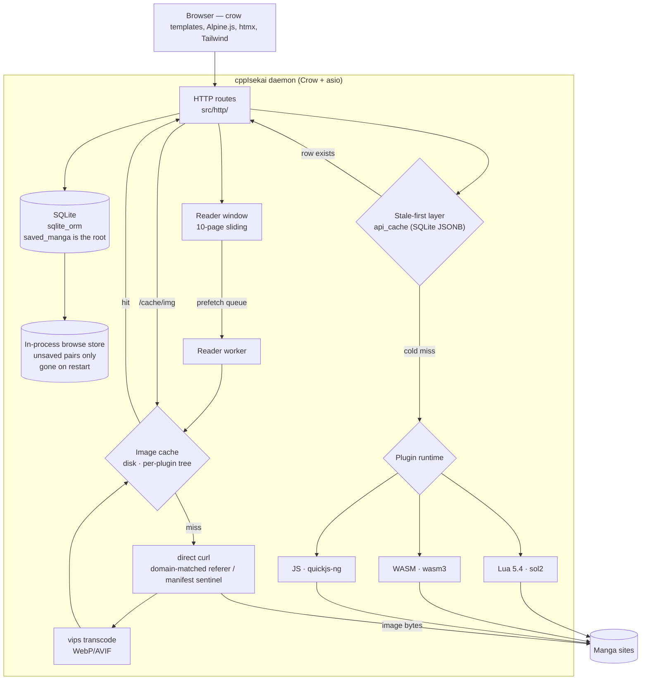
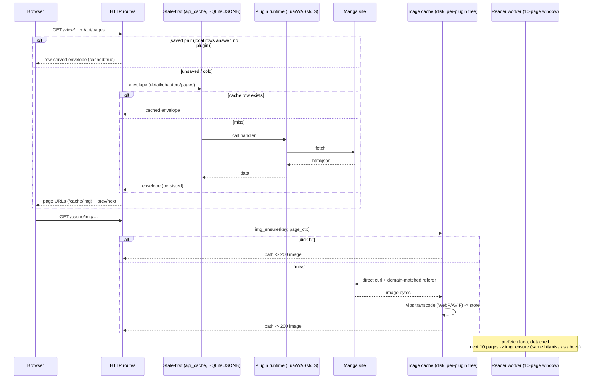
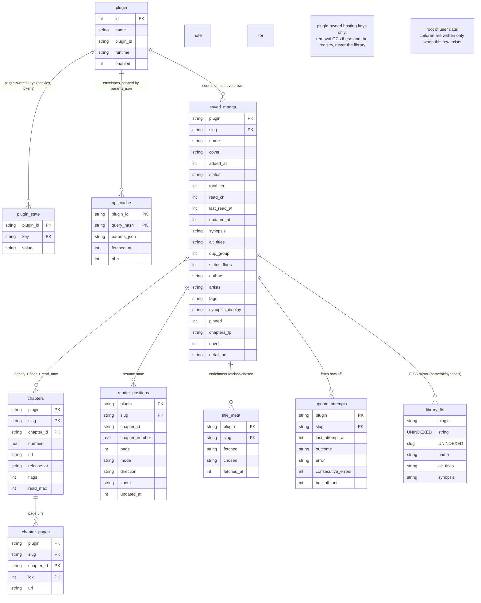

# cppIsekai

Local-first, self-hosted manga reader daemon for Linux. C++23, Crow HTTP, SQLite via sqlite_orm, plugin-per-site manga fetching with a stale-first cache. Single binary, no cloud, no account.

## Build

```bash
xmake -y
xmake test
./run-cppIsekai.sh
```

System prerequisites (Arch): `sudo pacman -S libvips curl`. Everything else comes from xrepo (see below) — no pacman crow/cli11/lua needed.
Server base URL: `http://localhost:8090`. Port precedence: `--port` > `$PORT` > `[server] port` in `data/cppisekai.ini` > 8090.

## Status (Nov 2026)

Everything below is implemented and verified against the running daemon.

- **Library** — save manga rows with name/cover, client-side search over title/alt-title/synopsis, 3-state sort with recent-read default, duplicate grouping (`dup_group`) and status flags. Pinned titles get their own section above the library grid. Adding a title promotes whatever the preceding open cached (detail fields, chapter rows, stats) onto local rows in the same tick — no plugin call; removing one wipes the pair (rows, cached envelopes, disk images), so re-adding equals a fresh add from search. Browsing without saving touches no database row at all: chapter state, positions and enrichment for an unsaved title live in process memory and vanish on restart, and are promoted into the library the moment the title is saved. Uninstalling a plugin keeps its library entries as *orphans* (local rows only, refreshed/revived as soon as a plugin with the same id is installed again); they are badged and filterable in the grid and can be purged in one call. Dim+blur covers render dimmed server-side (no unstyled flash on refresh).
- **Saved-row detail** — detail and the chapter list for saved rows serve from local rows (`saved_manga` display columns, `chapters` identity rows) regardless of cache age — only a cold miss or explicit refresh calls the plugin; enrichment data (MangaDex + a metadata aggregator: authors, artists, tags, synopsis) is materialized onto the row. Chosen alt-title/cover overrides apply on both live-fetch and row-serve paths, and the Fetch detail / Fetch covers wizard can restore the scraper's original values (SRC badge) per field. Novel/text sources are detected via the site's `medium` field: detail shows a badge + warning and the reader button is skipped.
- **Stale-first fetch** — plugin API responses are cached in `api_cache` (SQLite, raw-JSONB payload) and served local-first: any existing row wins, an aged one carries `cached:true`, and the network is used only on a cold miss or an explicit refresh. Per-method TTLs come from the plugin manifest (`cache_ttl`, else a host default); expired rows are pruned on the scheduler tick. Image bytes land in a disk LRU under `cache/img/` — `<ns>/cover/<sha>-<ratio>.<ext>` and `<ns>/manga/<slugdir>/ch<NNN>-<id8>/p<NNN>.<ext>` (zero-padded order = reading order); whole-file eviction on overflow.
- **Reader** — 10-page window, RTL/LTR, skip-aware, position resumed from the store, prev/next resolved by stable number order + index so duplicate chapter numbers (24a/24b) stay individually reachable; the reader links and prefetches by chapter id (`?ch_id=`), old number-only URLs keep working. Spread modes anchor at the page that was open, ↑/↓ pan the image and only change page at the edge, and zoom values persist per title.
- **Plugins** — per-site plugin-per-runtime; hosts expose a JSON ABI plus `http.fetch`, `storage.*`, `log.*`, `host.re2`, `host.html`, `host.crypto`, `host.text` (NFKD/casefold, `date_to_iso`) and `host.browser` (see Browser automation).
  - Lua 5.4 (sol2): MangaDex + 35 site ports (+ metadata-only enrichment sources `enrichment-mangadex`, `enrichment-mangaupdates`)
  - WASM (wasm3): two aggregator ports
  - JavaScript (quickjs-ng): one aggregator port
  - one WASM reader port is kept as a reference build; the maintained path for that site is its Lua plugin.
- **CBZ export** — `GET /export/cbz?plugin=&slug=` (libzippp).
- **Cover pipeline** — vips transcode to WebP/AVIF, `/cache/img` serves through the LRU.
- **Chapter state & migrate** — read/hidden flags live in one bitfield column per chapter row; bulk mark-all/clear-all and mark-previous from the detail page. Migrate source switches a saved title to another plugin in one transaction, carrying the read boundary and discarding per-page positions. Read progress (max page turned) is a master-row column (`chapters.read_max`) — the legacy `host/skip|read|total` key shadows are retired and boot-backfilled.
- **Action feedback** — every server-backed button shows a toast and flashes a LED on the clicked control; local-only interactions stay silent.
- **Maintenance** — VACUUM + snapshot backups on a configurable interval with a keep count (`[backup]` knobs, `GET`/`POST /api/backup`); restore stays a manual stop → copy → start. Optional system-tray with configurable labels/icon, and `xmake scan` runs ASan+UBSan then TSan and restores the release build.
- **API-first** — 59 HTTP routes + one log websocket (`/ws/log`), all reachable with curl; `/api/logs` exposes the log ring buffer and `/config` exposes the config registry.
- **About page** — renders this README.md live (see below).

## Architecture

**Components**



**Request lifecycle**



## Browser automation

Some sites render their page lists client-side only, so the host drives a headless
**Chrome** over CDP, using the vendored [CDP-for-CPP](https://github.com/ByteAshen/CDP-for-CPP)
(`third_party/cdp-cpp`, MIT). No external daemon, no second engine — the app spawns its own
Chrome (temp profile, killed with the app):

- at boot the daemon spawns headless Chrome; `chrome.command` (ini-only `[chrome]` section,
  `CPPISEKAI_CHROME_COMMAND`) overrides the binary, empty = auto-discover (stable channel first).
  Boot aborts when Chrome cannot be launched.
- one crash recovery per incident: the next browser call after a failure relaunches Chrome and
  retries once (3 s cooldown); a failed relaunch marks the backend dead for the process lifetime
  and later calls fail fast. Restarting the app resets it.
- all browser calls share one mutex and one working page; a harvest is never interleaved.
  `evaluate` awaits Promises (60 s cap inside the vendored eval), so one call can run a whole
  click-through harvest.
- localhost traffic bypasses the global `proxy` (loopback exemption in the fetch gate).

Plugins reach it through one passthrough, e.g. the page harvest:

```lua
host.browser.call("goto", { url = chapter_url })
local out = host.browser.call("evaluate", { script = HARVEST }) -- promise: scroll slots, collect img src
```

Manifest knob: `"image_referer": "none"` sends image fetches with no `Referer` at all (one CDN
403s any referer); any other value overrides the derived origin.

## Database

One SQLite file (`data/library.db`), one long-lived ORM connection (plus short raw opens for the JSONB and raw-SQL paths), all store access funneled through `src/store/` — plugins never touch SQLite directly (host `storage.*` only). There are **no enforced foreign keys**: every relationship is a logical key on the string pair `(plugin, slug)`, and `saved_manga` is the root of the data the user keeps. For a pair with no saved row the store keeps its browse state in process memory instead, so no child row can exist without a master row.



## System dependencies (shared, not vendored)

| Lib | Role |
|---|---|
| libvips | image processing, WebP/AVIF transcode |
| curl-impersonate (chrome) | plugin fetch fingerprint; system OpenSSL dlopen path for ff*/firefox fallback hosts |

## Via xrepo (`add_requires` in `xmake.lua`, pinned in `xmake-requires.lock`)

| Pkg | Pin | Role |
|---|---|---|
| crow | 1.3.5 | HTTP server framework (ssl=false, header-only) |
| asio | 1.36.0 | crow transitive dep, pinned |
| cli11 | 2.7.2 | flag parsing (header-only) |
| glaze | 9.1.0 | JSON (store/http serialization) — 7.9.0 does not compile; pinned with `xrepo update-repo` so the `v`-prefixed tag resolves |
| sol2 | 3.5.0 | Lua binding (plugin runtime) |
| lua | 5.4.8 | Lua 5.4 runtime (pinned; xrepo default is 5.5) |
| quickjs-ng | 0.15.1 | JS plugin runtime |
| sqlite_orm | 1.9.1 | store ORM |
| sqlite3 | 3.54.0 | store engine |
| thread-pool | 5.1.0 | BS::thread_pool worker pool |
| readerwriterqueue | 1.0.7 | SPSC queues |
| lexbor | 3.0.0 | HTML parse (plugin htmltext) |
| pugixml | 1.16 | XPath bridge for `host.html.xpath` |
| libzippp | 7.1 | CBZ export wrapper |
| utf8proc | 2.11.3 | Unicode NFKD + casefold |
| re2 | 2025.11.05 | regex (html text extraction) |
| hash-library | 2021.09.29 | `host.crypto.*` (SHA-256/MD5/HMAC) |
| simpleini | 4.27 | ini config read/write |
| spdlog | 1.17.0 | logging (+ zlib for crow compression) |
| zlib | 1.3.2 | crow compression |
| backward-cpp | pinned | crash stack traces |
| date | 3.0.4 | `host.text.date_to_iso` layout parsing |

## Engineering notes

- **Config** — one registry (`src/config/`): CLI flag + `CPPISEKAI_*` env + ini layers; precedence default < ini < env < flag. `--dump-config` renders the template, `POST /config` merge-saves.
- **Store ownership** — `saved_manga` is the root of everything the user keeps (chapters+flags+read_max, page URLs, position, enrichment, per-pair host fields as columns). A pair with no saved row routes to an in-process map instead of SQLite (`saved_exists` dispatch, LRU-bounded), so browse traffic can never orphan rows; a save promotes that map in one transaction. Orphan state is derived from the plugin registry, never stored.
- **Plugin ABI** — JSON-text in/out; single wrap point `call_cached` (`cached:true` stale-serve). Host-wide `CURLOPT_PROXY` via `plugin::applyProxy`.
- **Cache layout v4** — covers `<ns>/cover/<sha1(url)[:16]>-<ratio4>.<ext>`, pages `<ns>/manga/<slug[:40]>-<sha1(slug)[:8]>/ch<NNN>[-<id8>]/p<NNN>.<ext>` (zero-padded order = reading order), where `<ns>` is the plugin's display-name slug; the api layer is the `api_cache` table only (no on-disk api pool). Boot migrates the old tree once via the `.cache-v4-slugdir` stamp.
- **Build** — glaze/clang story: the toolchain is clang (`xmake f -m release`); see `knowledge/constraints/test-binary-releasedbg-vs-release` for why `xmake test` runs the releasedbg binary. Handy tasks: `xmake js` (minify + brotli the static assets), `xmake doc` (clang-doc HTML, or `XMAKE_DOC_FORMAT=md` for grep-friendly markdown), `xmake scan` (ASan+UBSan then TSan, always restores release), `xmake gate` (full gate).
- **Diagrams** — this file is the single source for GitHub and the in-app About page; Mermaid blocks render natively on GitHub and in-app via mermaid.js. Keep diagrams as ` ```mermaid ` fenced blocks.

## About page

The `/about` page fetches `README.md` from the repo root (`/about/readme`, per-request, never cached) and renders it with vendored `marked` + `mermaid` (`static/*.min.js.br`). Edits to this file show up on both GitHub and the app after a refresh — no rebuild needed (only a restart if the daemon was the one editing it).

## License

MIT — © 2026 kenzanin <kenzanin@gmail.com>. See [LICENSE](LICENSE).

