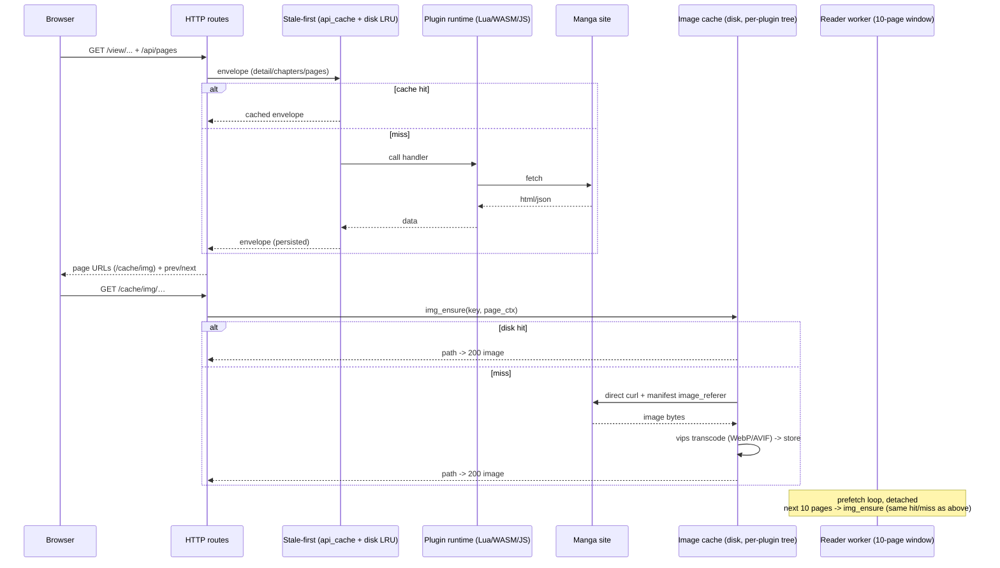
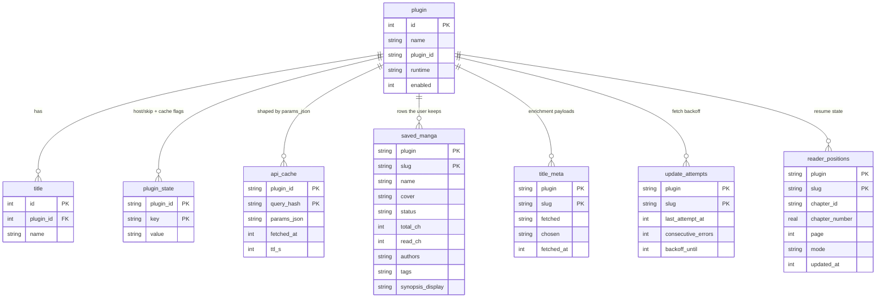

# cppIsekai

Local-first, self-hosted manga reader daemon for Linux. C++23, Crow HTTP, SQLite via sqlite_orm, plugin-per-site manga fetching with a stale-first cache. Single binary, no cloud, no account.

## Build

```bash
xmake -y
xmake test
./run-cppIsekai.sh
```

System prerequisites (Arch): `sudo pacman -S libvips curl`. Everything else comes from xrepo (see below) — no pacman crow/cli11/lua needed.
Server base URL: `http://localhost:8090`. Port precedence: `--port` > `$PORT` > `[server] port` in `data/cppisekai.ini` > 8090.

## Status (Nov 2026)

Everything below is implemented and verified against the running daemon.

- **Library** — save manga rows with name/cover, search with Unicode NFKD + casefold normalization, duplicate grouping (`dup_group`) and status flags.
- **Saved-row detail** — detail/chapters for saved rows serve from SQLite without calling the plugin; enrichment data (MangaDex/MangaUpdates: authors, artists, tags, synopsis) is materialized onto the row. Chosen alt-title/cover overrides apply on both live-fetch and row-serve paths.
- **Stale-first fetch** — plugin API responses are cached in `api_cache` (SQLite, with raw-JSONB payload) and served stale-on-error; image bytes land in a disk LRU under `cache/` (layout v2: `<plugin>/covers/<slug>.<ext>`, `<plugin>/<slug>/chNNN/pNNN.<ext>`; whole-file eviction on overflow).
- **Reader** — 10-page window, RTL/LTR, skip-aware, position resumed from the store, prev/next resolved by stable number order + index so duplicate chapter numbers (24a/24b) stay individually reachable; the reader links and prefetches by chapter id (`?ch_id=`), old number-only URLs keep working.
- **Plugins** — per-site plugin-per-runtime; hosts expose a JSON ABI plus `http.fetch`, `storage.*`, `log.*`, `host.re2`, `host.html`, `host.crypto`, `host.text` (NFKD/casefold, `date_to_iso`).
  - Lua 5.4 (sol2): anisascans, atsumaru, mangadex, mangafire (+ metadata-only enrichment sources `enrichment-mangadex`, `enrichment-mangaupdates`)
  - WASM (wasm3): mangafox, mangafreak
  - JavaScript (quickjs-ng): mangatown
  - mangafox reader is currently broken (upstream URL/shape change); tracked in `openspec/changes/plugin-port-multi-runtime/`.
- **CBZ export** — `GET /export/cbz?plugin=&slug=` (libzippp).
- **Cover pipeline** — vips transcode to WebP/AVIF, `/cache/img` serves through the LRU.
- **About page** — renders this README.md live (see below).

## Architecture



## Database

One SQLite file (`data/library.db`), one connection, all store access funneled through `src/store/` — plugins never touch SQLite directly (host `storage.*` only). Relationships are **logical** keys (`plugin` columns hold the plugin slug); the only enforced FK is `title.plugin_id → plugin.id`.



## System dependencies (shared, not vendored)

| Lib | Role |
|---|---|
| libvips | image processing, WebP/AVIF transcode |
| curl-impersonate (chrome) | plugin fetch fingerprint; system OpenSSL dlopen path for ff*/firefox fallback hosts |

## Via xrepo (`add_requires` in `xmake.lua`, pinned in `xmake-requires.lock`)

| Pkg | Pin | Role |
|---|---|---|
| crow | 1.3.5 | HTTP server framework (ssl=false, header-only) |
| asio | 1.36.0 | crow transitive dep, pinned |
| cli11 | 2.7.2 | flag parsing (header-only) |
| glaze | 9.1.0 | JSON (store/http serialization) — 7.9.0 does not compile; pinned with `xrepo update-repo` so the `v`-prefixed tag resolves |
| sol2 | 3.5.0 | Lua binding (plugin runtime) |
| lua | 5.4.8 | Lua 5.4 runtime (pinned; xrepo default is 5.5) |
| quickjs-ng | 0.15.1 | JS plugin runtime |
| sqlite_orm | 1.9.1 | store ORM |
| sqlite3 | 3.54.0 | store engine |
| thread-pool | 5.1.0 | BS::thread_pool worker pool |
| readerwriterqueue | 1.0.7 | SPSC queues |
| lexbor | 3.0.0 | HTML parse (plugin htmltext) |
| pugixml | 1.16 | XPath bridge for `host.html.xpath` |
| libzippp | 7.1 | CBZ export wrapper |
| utf8proc | 2.11.3 | Unicode NFKD + casefold |
| re2 | 2025.11.05 | regex (html text extraction) |
| hash-library | 2021.09.29 | `host.crypto.*` (SHA-256/MD5/HMAC) |
| simpleini | 4.27 | ini config read/write |
| spdlog | 1.17.0 | logging (+ zlib for crow compression) |
| date | 3.0.4 | `host.text.date_to_iso` layout parsing |

## Engineering notes

- **Config** — one registry (`src/config/`): CLI flag + `CPPISEKAI_*` env + ini layers; precedence default < ini < env < flag. `--dump-config` renders the template, `POST /config` merge-saves.
- **Plugin ABI** — JSON-text in/out; single wrap point `call_cached` (`cached:true` stale-serve). Host-wide `CURLOPT_PROXY` via `plugin::applyProxy`.
- **Cache layout v2** — `<plugin>/covers/<slug>.<ext>`, `<plugin>/<slug>/chNNN/pNNN.<ext>` (zero-padded order = reading order), stale `api/<sha>.json` on disk plus the `api_cache` table; boot scan purges once via `.cache-v2` stamp.
- **Build** — glaze/clang story: the toolchain is clang (`xmake f -m release`); see `knowledge/constraints/test-binary-releasedbg-vs-release` for why `xmake test` runs the releasedbg binary.
- **Diagrams** — this file is the single source for GitHub and the in-app About page; Mermaid blocks render natively on GitHub and in-app via mermaid.js. Keep diagrams as ` ```mermaid ` fenced blocks.

## About page

The `/about` page fetches `README.md` from the repo root (`/about/readme`, per-request, never cached) and renders it with vendored `marked` + `mermaid` (`static/*.min.js.br`). Edits to this file show up on both GitHub and the app after a refresh — no rebuild needed (only a restart if the daemon was the one editing it).

## License

MIT — © 2026 kenzanin <kenzanin@gmail.com>. See [LICENSE](LICENSE).
